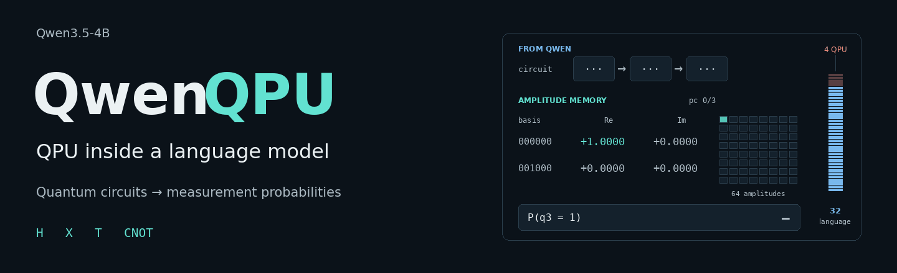
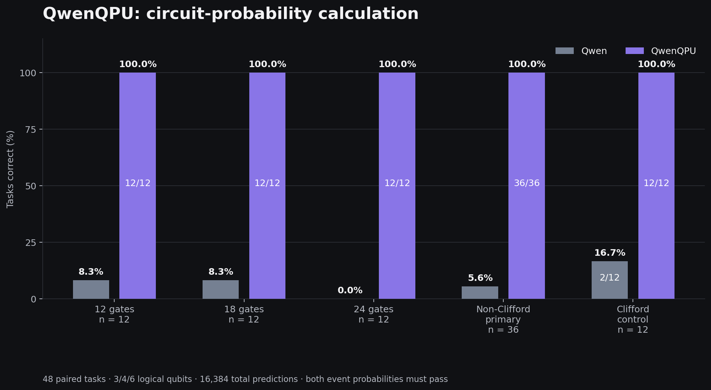
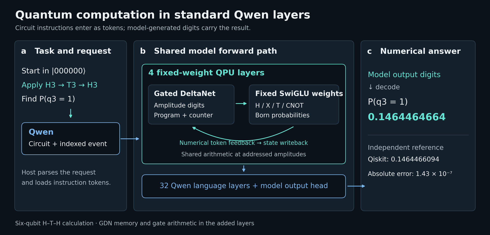
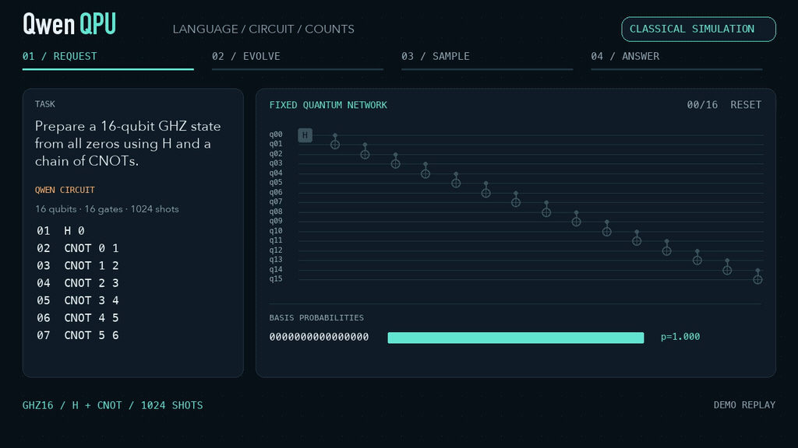

<p align="center">
  
</p>

[简体中文](README.zh-CN.md) · [Standard-layer implementation](docs/ADDED_LAYERS.md) · [Benchmark](docs/BENCHMARK_ADDED_LAYERS.md) · [Hugging Face](https://huggingface.co/xi-zhao/QwenQPU)

QwenQPU adds a fixed-weight QPU to Qwen3.5-4B. Four standard Qwen layers store
quantum amplitudes, execute H/X/T/CNOT circuits and return measurement-event
probabilities. Qwen reads the task and supplies the circuit; the added layers
produce the numerical answer in the model's forward pass.

## Benchmarks



Starting from the all-zero state, apply a supplied circuit and calculate two
specified measurement-event probabilities. The paired benchmark contains
48 circuits on 3, 4 and 6 qubits, with 12, 18 or 24 sequential gates. Both
conditions use the same language weights and a 16,384-prediction total budget;
QwenQPU's native execution predictions count toward that budget.

**Qwen: 4/48 (8.3%). QwenQPU: 48/48 (100%).**

| Calculation tasks | Qwen | QwenQPU |
|---|---:|---:|
| Non-Clifford circuits (36) | 2/36 | **36/36** |
| Clifford controls (12) | 2/12 | **12/12** |
| All paired tasks (48) | 4/48 | **48/48** |

Both requested probabilities must agree with independent Qiskit values within
`5e-5`. QwenQPU must also preserve the requested circuit and measurement events.
Its maximum probability error is `1.421e-5`.
[Tasks, methods and full results](docs/BENCHMARK_ADDED_LAYERS.md).

The added layers turn 44 incorrect answers into correct calculations; both
conditions answer the other four tasks correctly. For a six-qubit H3–T3–H3 example, QwenQPU returns
`P(q3=1) = 0.1464464664`; the reference is `0.1464466094`.
A six-qubit GHZ circuit returns `0.5` for both all-zero and all-one outcomes.
[Complete requests and results](evidence/added-layers/completed-demonstrations.json).

## How it works



The language model and QPU share one `Qwen3_5ForCausalLM` checkpoint layout.
Gated DeltaNet states hold amplitude digits, instructions and the program counter.
Fixed SwiGLU weights perform the small-gate arithmetic and probability readout.
The same arithmetic is reused at different amplitude addresses. Numerical output
tokens feed back into the model to write the next state.

The host parses the request, loads instructions, schedules measurement queries
and decodes output digits. The model computes state updates and probabilities.
The assembled model retains 32 language layers, replaces the inherited CPU
prefix with four QPU layers, and uses the stock Transformers forward method.
[Implementation and completed tests](docs/ADDED_LAYERS.md).

## Quickstart

```bash
git clone https://github.com/xi-zhao/QwenQPU && cd QwenQPU
python research/standard_layers/build_prefix.py --out ./models/qpu-prefix
python research/standard_layers/demo_repaired_full_model.py \
  --base ./models/Qwen3.5-4B-Qwenputer \
  --prefix ./models/qpu-prefix \
  --out ./reproduced/added-layer-demo
```

Use the existing local language checkpoint and the dependencies in the
[setup instructions](docs/ADDED_LAYERS.md#build-and-run). The prefix constructor
writes about 1.42 GB of fixed weights. Full assembly uses 36.67 GB of FP32 weights.
[Weight manifest](evidence/added-layers/weight-manifest.json).

## Circuit example

<p align="center"></p>

The 16-qubit example computes two event probabilities after 161 gates.
[Video](assets/demo.mp4) · [Benchmark and worked example](docs/BENCHMARK.md) ·
[Runtime](docs/ARCHITECTURE.md).

## Citing

```bibtex
@software{qwenqpu2026,
  author = {xi-zhao},
  title  = {{QwenQPU}: QPU inside a language model},
  year   = {2026},
  url    = {https://github.com/xi-zhao/QwenQPU}
}
```

The inherited language checkpoint and standard-layer construction approach come
from [Qwenputer](https://github.com/divagr18/qwenputer).
[Attribution and component terms](docs/LICENSES.md).
