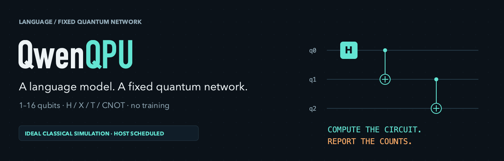
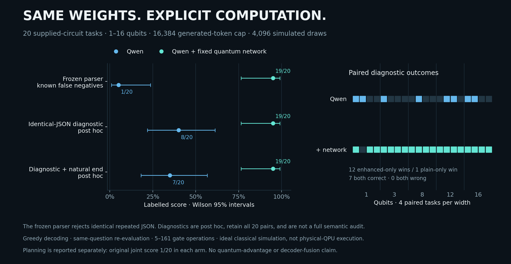

# QwenQPU

[English](README.md) · [实现边界](docs/ARCHITECTURE.md) · [证据与局限](docs/EVIDENCE.md)

让 Qwen 提交量子线路，由固定权重的量子态向量网络执行，再根据 counts 回答。
当前实现是**理想经典模拟、宿主显式调度、独立量子态**；量子模块在复合模型
的 forward 中运行，语言 generate 单独调用。标准 decoder / KV 融合尚未完成。


动画中的 Qwen 线路、counts 和回复来自已验证的 A100 GHZ16 对话；中间态由
未改动的固定核心在本地逐门重放。播放速度仅用于展示。线路演化一次，再从
最终分布抽样1024次；这不是1024次真实QPU作业。完整[MP4](assets/demo.mp4)和
[生成源码](tools/render_assets.py)一并提供。

## 快速体验

```bash
git clone https://github.com/xi-zhao/QwenQPU.git
cd QwenQPU
```

```bash
python examples/replay_recorded.py # 只读历史对话，不运行大模型
python examples/ghz.py --qubits 16 --shots 1024 --seed 123 # 需要已有PyTorch
```

第二个命令实际运行固定网络；已验证 counts 为全零534、全一490。
支持1–16比特、H/X/T/CNOT、每次RESET之间最多1000个顺序门操作。
默认只返回shots/counts；宿主负责验证、展开重复、随机数和计数汇总。

## 如实报告结果

同一模型、20道给定线路计算题、每题每组累计16384生成token：

|口径|纯Qwen|Qwen＋固定网络|
|---|---:|---:|
|原冻结自动分（受解析器缺陷影响）|1/20|19/20|
|事后合并相同重复JSON的窄诊断|8/20|19/20|
|上述诊断正确且自然结束|7/20|19/20|

原解析器把重复出现的同一正确JSON误判为歧义。原分数未改；事后诊断不等于
完整人工语义评分，也不是新的预注册结果。规划题原联合分两组均1/20。
这批小型合成题不代表所有量子任务，不证明量子优势或优于外接模拟器。



新模型下载入口**待发布**。本目录不含约18.7GB语言权重；仅包含已测试可加载
的48个固定门参数小样。HF注册与上传仍暂停；GitHub中的代码、动画和证据
与语言模型权重分开。新代码与素材尚未指定项目级开源许可，上游材料沿用
各自条款，详见[许可与来源](docs/LICENSES.md)。
