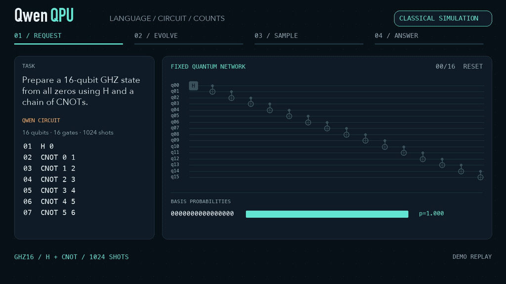
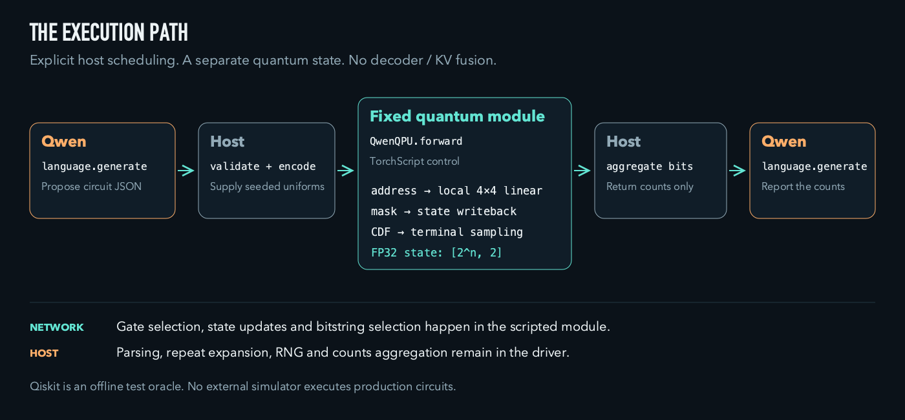

<p align="center">
  
</p>

QwenQPU 权重：正在发布  
语言权重：[Hugging Face](https://huggingface.co/divagr1925/Qwen3.5-4B-Qwenputer)  
[English](README.md) · [架构](docs/ARCHITECTURE.md) · [实测证据](docs/EVIDENCE.md)

**QwenQPU 为 Qwen 加入一个固定权重的量子执行模块：由 H、X、T、CNOT 构成的
1–16 比特态向量网络。** Qwen 给出线路，网络计算量子态并抽样，Qwen 再依据
counts 继续回答。门系数由数学构造得到，不需要训练。

量子寄存器保存振幅的实部和虚部。固定小矩阵更新振幅对，控制掩码实现 CNOT，
最终态提供末端测量样本。量子计算由复合模型的 forward 调用脚本化量子子模块完成；
宿主驱动调度语言调用、指令与读出。这是理想经典模拟。

当前模块在每次重置之间接受最多1000个顺序门操作。独立 Qiskit 对照已覆盖
16比特非 Clifford 线路等执行情况。

<p align="center"></p>

## 基准测试

两组使用同一语言权重、贪心解码，每题每组累计最多生成16384个 token。
纯 Qwen 没有执行模块；QwenQPU 使用固定量子网络和4096次末端抽样。
共有20道给定线路计算题及20道辅助规划题。这是原题复测，不是新的盲测。

|任务及评分口径|纯 Qwen|**QwenQPU**|
|---|---:|---:|
|计算题，合并相同重复 JSON 的事后窄诊断（20题）|8/20|**19/20**|
|计算题，同一诊断正确且自然结束（20题）|7/20|**19/20**|
|规划题，原联合指标（20题）|1/20|1/20|

计算题两行是明确标注的**事后诊断**。原冻结解析器把相同正确 JSON 的重复出现
误判为歧义，受影响的原分为1/20对19/20。合并相同对象的诊断不等于完整人工
语义评分。该诊断下，QwenQPU 单独答对12对、纯 Qwen 单独答对1对、双方都对7对；
成对 bootstrap 差值为55个百分点，描述性95%区间为30–80个百分点。
规划能力没有显示改善。[评分定义、逐题配对与失败边界](docs/EVIDENCE.md)。

这轮比较实际产生的38次量子调用全部通过独立执行与抽样核验。最大振幅分量
误差4.531e-7，最大概率误差7.308e-8。执行器正确仍可能被 Qwen 解释错。
这组小型合成题不证明量子优势或优于外接模拟器。

## 快速开始

已有 Python 和 PyTorch 时：

```bash
git clone https://github.com/xi-zhao/QwenQPU && cd QwenQPU
python examples/ghz.py --qubits 16 --shots 1024 --seed 123
```

命令实际在 CPU 运行固定网络，结果为全零534次、全一490次。
只查看已记录的真实 Qwen 对话，无需加载语言权重：

```bash
python examples/replay_recorded.py
```

已有本地语言 checkpoint 时，可尝试新的“语言→线路→counts→语言”对话：

```bash
python examples/qwen_local.py \
  --model-path /path/to/an/existing/Qwen3.5-4B-Qwenputer \
  --output ./review/dialogue.json
```

驱动让 Qwen 输出线路 JSON，验证并编码后调用固定量子模块，再把观测 counts
交回 Qwen。语言 generate 与量子 forward 是宿主循环中的两次独立调用。
继承的语言模型使用标准 HF `Qwen3_5ForCausalLM`；量子算法不交给上游 Qwenputer
神经 CPU 执行。语言权重保持不变，新增量子模块尚未融合进原 decoder/KV 状态。
可选对话有总生成上限，不会自动修补失败答案。

历史完整模型运行使用 A100 80GB。本次展示准备检查了 CPU 核心、参数加载和
小型示例，没有重跑完整语言模型入口。[环境及复现命令](docs/REPRODUCING.md)。

<p align="center"></p>

*Qwen 线路与回复取自真实记录，中间态由未改动的核心重放。播放速度用于展示，
样本来自理想经典模拟。[MP4](assets/demo.mp4) · [轨迹](assets/demo-trace.json) ·
[生成源码](tools/render_assets.py)。*

实现在 [`src/qwenqpu/`](src/qwenqpu)，[架构说明](docs/ARCHITECTURE.md)记录计算图、
量子状态和宿主边界。

## 用量子态保存状态

<p align="center"></p>

寄存器是形状为 `[2**n, 2]` 的 FP32 张量，每个计算基振幅对应实部与虚部。
新会话从全零基态开始。每个指令通过动态索引取出受作用的振幅对，施加固定
4×4实矩阵，再通过掩码写回。CNOT 只在控制比特为1的位置执行 X 更新。

这里使用局部门矩阵，不构造稠密的 `2**n × 2**n` 全局门算符，也不为所有门
分别复制状态。态向量内存仍随比特数指数增长。TorchScript 整数控制位于 CPU，
地址和状态张量运算运行于所选 CPU/CUDA 设备。门选择、振幅更新和末端位串选择
留在脚本化量子模块中；宿主负责 JSON、重复段展开、随机数和计数汇总。

量子寄存器独立于语言状态，没有把 Qwen 的 Gated DeltaNet 头改作量子 RAM。
Qiskit 只用于离线核验，生产执行不会调用它。

## 固定门执行（实验性）

H、X、T 对应三个4×4实矩阵，共48个固定 FP32 系数；CNOT 通过控制掩码复用 X。
[参数小包](weight-release/module-bundle/qwenqpu_module.json)存的是这些数学常量，
不是训练后的完整语言模型。加载器检查文件校验值、核心身份与精确门值。

|寄存器|门|顺序执行上限|读出|
|---|---|---:|---|
|1–16比特|H、X、T、CNOT|每次重置之间1000个门操作|1–10000次末端抽样|

1000指门操作数，不是并行线路深度。本次计算题实际包含5–161个门操作。
当前没有训练、噪声模型或中途测量。

## 持续状态执行（实验性）

脚本化的 `LocalGateStatevector` 可以分段接收指令，同时保留寄存器和累计门数。
不同模块实例的状态相互隔离。`reset_()` 恢复全零基态并清零指令计数；末端抽样
后开始另一条线路需要先重置。

理想线路只演化一次。驱动为每个 shot 提供一个有种子的均匀随机数，图内计算
CDF 并选出位串，宿主汇总 counts。`q0` 为最低有效位，16比特按 `q15..q0` 输出。
这些抽样不是重复执行真实 QPU 作业。精确概率只用于诊断，不会伪装成抽样 counts
发送给 Qwen。

## 第一版（三比特）

直接网络原型使用三个比特、16个实数状态分量。当前实现将同一固定门方法扩至
1–16比特，仍可使用同一核心运行三比特情况：

<details><summary>三比特示例及本地检查</summary>

```bash
python examples/ghz.py --qubits 3 --shots 1024 --seed 123
python -m unittest discover -s tests -v
```

检查覆盖历史 GHZ16 与相位干涉 counts、分段执行/重置及状态隔离、非法指令、
门数上限和固定参数导出加载。它们是小型运行检查，与历史 A100/Qiskit 核验及
语言评测分开记录。

</details>

更多内容见 [`docs/`](docs)：[架构](docs/ARCHITECTURE.md)、[评测](docs/EVIDENCE.md)、
[复现](docs/REPRODUCING.md)及[媒体来源](docs/MEDIA.md)。语言权重、量子门参数和
宿主运行代码是不同组件；单独加载标准 HF 语言模型不会自动接上量子模块。

## 引用

```bibtex
@software{qwenqpu2026,
  author = {xi-zhao},
  title  = {{QwenQPU}: Qwen with a fixed quantum state-vector network},
  year   = {2026},
  url    = {https://github.com/xi-zhao/QwenQPU}
}
```

本项目基于 Qwen，并受 [Qwenputer](https://github.com/divagr18/qwenputer) 启发。
语言 checkpoint 及编译式计算思路的来源保留原作者归属。

## 许可

上游 Qwenputer 代码为 MIT，继承的语言权重声明为 Apache-2.0。
QwenQPU 原创代码和素材尚未指定项目级开源许可，公开发布不新增许可授权。
[组件条款与来源](docs/LICENSES.md)。
