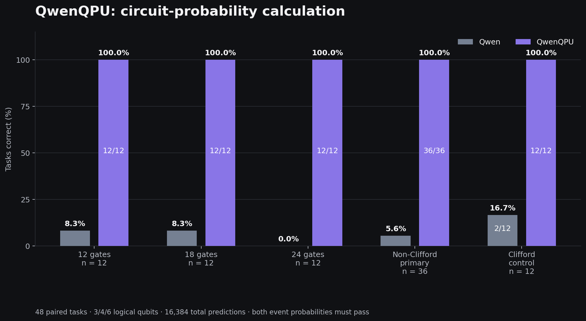
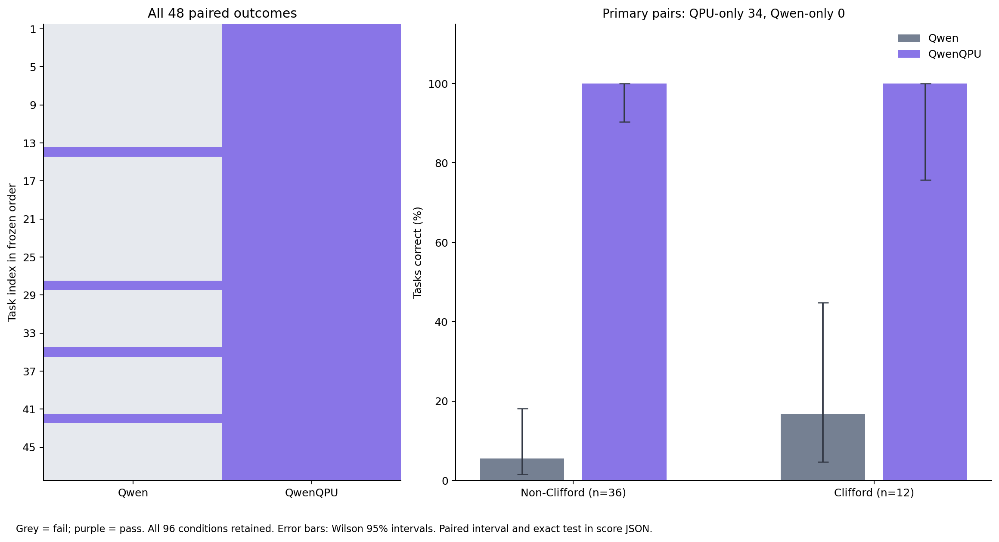
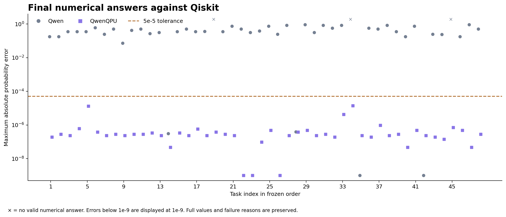
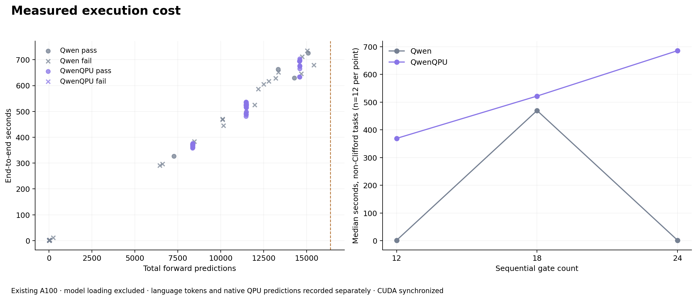

# Supplied-circuit probability benchmark (r5)

## Tasks

Every task starts from the all-zero state, supplies an ordered H/X/T/CNOT
circuit and asks for two computational-basis event probabilities. Event A
fixes one qubit; event B fixes two. All other qubits are marginalized.

The fixed set has 36 non-Clifford tasks: 3, 4 and 6 logical qubits × 12, 18
and 24 sequential gates × four circuits. Twelve Clifford controls use 18 gates,
four circuits at each register size. Gate count counts sequential operations.

Before model inference, candidates were selected by physical properties:
connected interaction graph, entangled final state, probabilities in
`[0.025, 0.975]`, and, for non-Clifford circuits, at least one requested
probability more than `0.001` from a multiple of `1/16`. Selection never used
model answers. Independent NumPy and Qiskit references agreed on all 48 tasks
and the two separate interface probes (maximum probability difference
`6.66e-16`). The probes are excluded from the benchmark.

[The complete fixed task list](../evidence/added-layers/r5-tasks.json) contains
the circuits, event conditions, prompts and generation seeds. Its SHA256 is
`b6d892f5441f7b66fcc63d3c4a194188b5b84c410376225ae9d779feb01d0759`.
The formal source/protocol manifest was frozen at 2026-11-03 18:43:02 UTC;
its SHA256 is `37f03134726b33a8c78785dfd1f4e41a067e71560fcc3c70f36ef624f3f00421`.

## Paired conditions

Both conditions use the same assembled checkpoint and supplied task. Plain
Qwen has quantum execution disabled. QwenQPU receives the native function
schema and its numerical QPU output is the final answer. The shared prompt
asks for immediate function submission when the function is available.
The [interface](../research/standard_layers/benchmark_native_r5/tool_interface.py)
contains the exact system text and schema.

Both have a total budget of 16,384 generated predictions. This counts language
tokens, function arguments and every native QPU forward prediction. Model
outputs are fed back for execution; host-supplied control inputs are recorded
separately. Expected QPU costs are 8,231, 11,315 and 14,399 predictions for
12, 18 and 24 gates. The budget does not reset at a function call.

Decoding uses the native non-thinking template, temperature 1, top-p 0.95,
top-k 20, presence penalty 1.5 and repetition penalty 1. Each task's recorded
generation seed is shared by its two conditions. Task order is fixed with
shuffle seed 2026110348; which arm runs first alternates. The per-condition
safety limit is 3,600 seconds; infrastructure failures pause scheduling.

This benchmark asks for numerical probabilities, so there is no shots-based
estimate. A task passes when both answers are within absolute `5e-5` of
independent complex128 Qiskit values. QwenQPU's submitted events must match,
and the submitted circuit must produce the same final state on the supplied
input (infidelity below `1e-10`). Identical repeated JSON answers are merged;
conflicting answers fail. Incorrect numbers, malformed calls, truncation and
time exhaustion remain in the denominator. Completed failures are not retried.

## Final results — 48 paired tasks

The run finished at **2026-11-04 04:46:32 UTC**. All 96 conditions are included.

| Task family | Tasks | Qwen correct | QwenQPU correct |
|---|---:|---:|---:|
| Non-Clifford (primary) | 36 | 2/36 (5.6%) | 36/36 (100%) |
| Clifford controls | 12 | 2/12 (16.7%) | 12/12 (100%) |
| All pairs | 48 | 4/48 (8.3%) | 48/48 (100%) |

The primary comparison has 34 QwenQPU-only successes, two shared successes
and no Qwen-only success. Across all 48 tasks, the counts are 44, four and zero.
QwenQPU's largest absolute probability error is `1.4209656971742035e-5`.

| Logical qubits | Tasks | Qwen | QwenQPU |
|---|---:|---:|---:|
| 3 | 16 | 3/16 | 16/16 |
| 4 | 16 | 0/16 | 16/16 |
| 6 | 16 | 1/16 | 16/16 |

Within the 36 non-Clifford tasks, the 12-, 18- and 24-gate strata each have
12 tasks. Qwen scores 1/12, 1/12 and 0/12; QwenQPU scores 12/12 in each stratum.
The three gate strata partition the primary group shown in the main figure.

### Uncertainty and failures

Wilson 95% intervals for overall correctness are 3.29–19.55% for Qwen and
92.59–100% for QwenQPU. The paired improvement is 91.67 percentage points;
its conservative exact 95% interval is 69.50–98.12 points. This interval uses
the Bonferroni union of two 97.5% Clopper–Pearson intervals for discordant
pairs. The two-sided exact McNemar p-value is `1.1368683772161603e-13`.
For the primary non-Clifford endpoint, the paired improvement is 94.44 points,
with a conservative exact 95% interval of 67.81–99.53 points.

Qwen has 41 numerically incorrect answers, two conflicting-answer failures,
and one answer missing the required A/B probabilities. All remain in the
denominator. Its 48 generations ended at EOS. All 48 QwenQPU calls reached
numerical completion; none exhausted the prediction budget. No completed
condition was regenerated. These are one-seed results for the fixed task set.

### Execution cost

| Measurement | Qwen | QwenQPU |
|---|---:|---:|
| Language predictions, total | 238,639 | 8,007 |
| Native QPU predictions, total | 0 | 543,120 |
| End-to-end seconds, total | 11,138.90 | 24,974.09 |
| End-to-end seconds, median | 1.87 | 524.20 |

The Qwen latency distribution contains both short incorrect answers and long
generations; its median alone does not describe that distribution. The cost
plot includes every success and failure. Timings exclude model loading and
include decoding, native execution and progress I/O, with CUDA synchronization.
Peak allocated memory was 38,555,899,904 bytes for Qwen and 38,399,002,624 bytes
for QwenQPU. The model and supervisor exited; the final GPU check showed
1 MiB used and 81,038 MiB free.

### Figures and reproduction


[PDF](../assets/r5/benchmark-main.pdf) · [SVG](../assets/r5/benchmark-main.svg)


[PDF](../assets/r5/benchmark-paired.pdf) · [SVG](../assets/r5/benchmark-paired.svg)


[PDF](../assets/r5/benchmark-errors.pdf) · [SVG](../assets/r5/benchmark-errors.svg)


[PDF](../assets/r5/benchmark-cost.pdf) · [SVG](../assets/r5/benchmark-cost.svg)

```bash
python tools/render_r5_results.py
```

The renderer uses the [96-condition data extract](../evidence/added-layers/r5-plot-data.json),
whose SHA256 is `051643542579d3c78719c4db2fd6a3d777d5d447e6b8acccbf6ae2e94c52b9f6`.
The extract preserves task order, both errors, outcome, elapsed time and
language/native prediction counts, also available as [CSV](../evidence/added-layers/r5-per-condition.csv).
[Final statistics](../evidence/added-layers/r5-final.json)
and [figure metadata](../assets/r5/figure-metadata.json) identify their source.

The complete score SHA256 is `30c541cf0dd4be7b70353cfbb5a5e63f986bad120c69fa4793daef7a5acb3d59`.
Independent integrity review checked 96 raw records, all 27 frozen file hashes,
prompts, tool availability, seeds, token accounting, parsers and score consistency.
The complete reviewed archive is `QwenQPU-native-benchmark-r5-reviewed.zip`
(5,269,820 bytes; SHA256 `58870ed526b9a9d0191607df4d7075688e0eee550278942143a7352d578f93bc`).
Original failures and raw model outputs are retained in that archive.

## Earlier snapshot — 27 paired tasks

Snapshot: **2026-11-04 00:26:20 UTC**, 54 terminal conditions. The full run is
in progress at that time; the table describes the completed pairs at this snapshot.

| Task family | Completed / planned tasks | Qwen correct | QwenQPU correct |
|---|---:|---:|---:|
| Non-Clifford (primary) | 20 / 36 | 1 / 20 | 20 / 20 |
| Clifford controls | 7 / 12 | 0 / 7 | 7 / 7 |
| All completed pairs | 27 / 48 | 1 / 27 | 27 / 27 |

There are 26 QwenQPU-only successes and one shared success. Plain Qwen has
25 incorrect probability answers and one conflicting-answer failure.
QwenQPU's maximum probability error is `1.326e-5`. All 27 frozen file hashes
matched, and scoring left the completed source records unchanged.
[Machine-readable snapshot](../evidence/added-layers/r5-interim.json).

The [earlier composite benchmark](BENCHMARK.md) used a different execution
path, task set and measurement-count interface and is reported separately.
